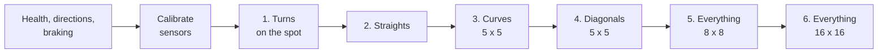
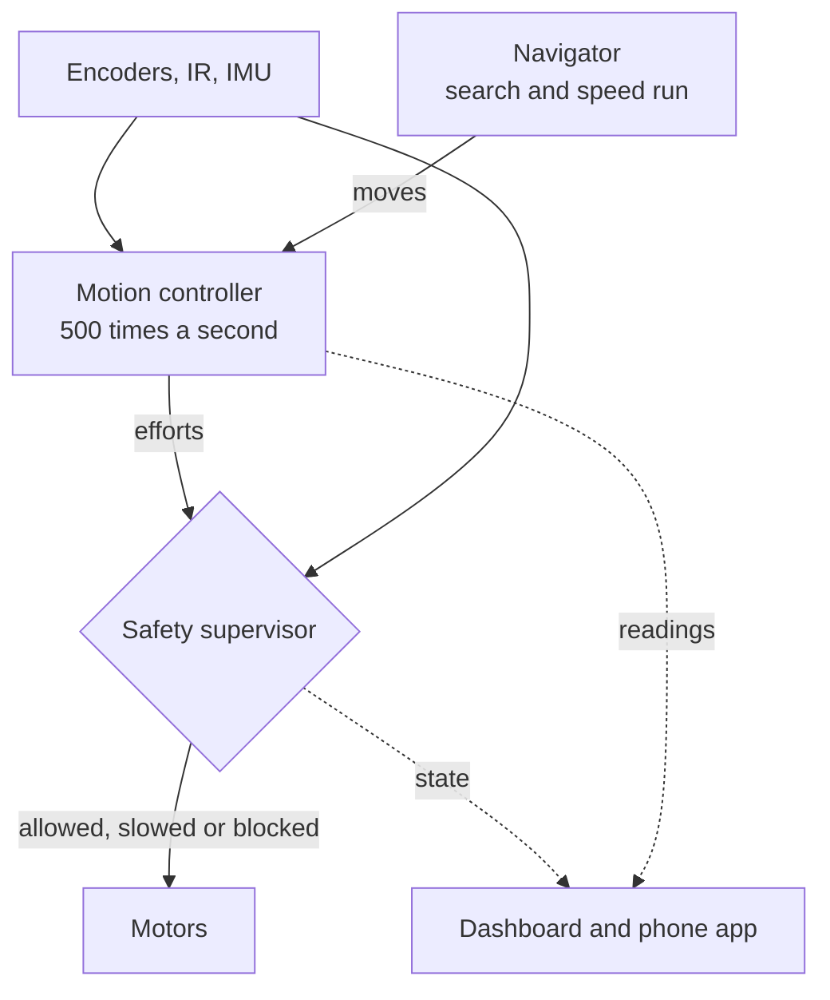
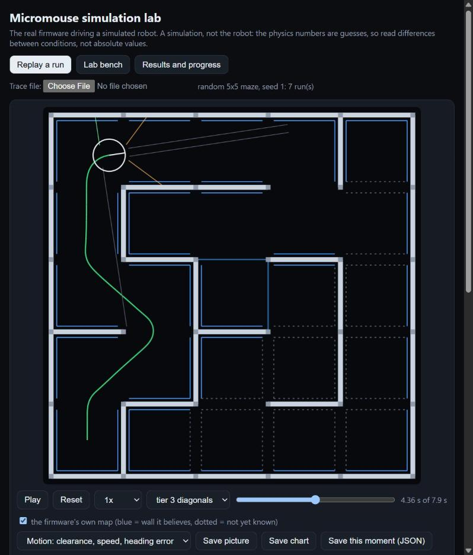
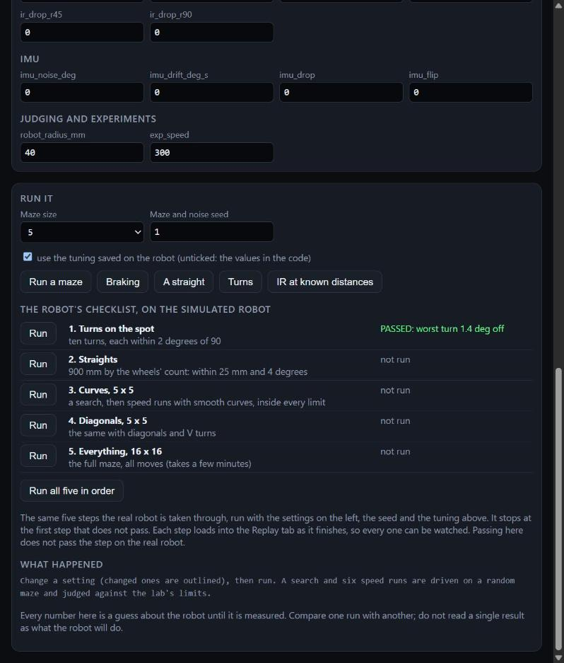

# Micromouse-2027: control, safety and tuning (`pid-controls` branch)

Firmware, a simulation lab and two browser pages for getting a micromouse to drive as fast as it cleanly can: turns on the spot, straights, smooth curves, diagonals, then the full 16 x 16 maze, each proven before the next is tried.

It is built on the **Antigravitieee** robot (ESP32-S3-DevKitC-1, Pololu Motoron M2T256, N20 gearmotors with magnetic encoders, Bosch BNO055 IMU, six IR wall sensors), which is the demonstration robot. [Using it on another robot](#using-this-on-another-robot) says what carries over to a different chassis.

> **What has and has not been tried.** The hand controls, tilt stop, calibration and stop-and-turn search on this branch's parent were driven on the real robot on 2026-10-10. Everything added on this branch (the safety supervisor, the braking measurement, the checklist, the limits test, curves and diagonals chosen at run time, the 8 x 8 size) has been **compiled and run on the simulated robot only**. The simulation's physics numbers are guesses, so it shows which way a change pushes things, not what the robot will do.

## The idea in one picture



Each numbered step is run again and again, a little faster each time, until it stops being clean. The robot then keeps the fastest clean speed, takes one step back from the one that failed, and opens the next step. A step cannot be started until the one before it is finished.



The safety supervisor sits between the controller and the motors and does its own sum every tick: can the robot still stop in the room the front sensors see? If not it brakes, whatever the controller wanted.

## 1. On the real robot

### Flash it

```powershell
~/.platformio/penv/Scripts/pio.exe run -e main -t upload     # with Bluetooth and Wi-Fi, for tuning
~/.platformio/penv/Scripts/pio.exe run -e competition -t upload   # radios off, hand controls only
```

### Open the dashboard

```powershell
cd tools/web_dashboard
python -m http.server 8000
```

Open <http://localhost:8000> in Chrome or Edge and press **Connect** (Bluetooth) or **Connect by USB**. The card **"Getting the real robot ready, in order"** has one row per step, each with its buttons, and marks the checklist rows done, open or locked from what the robot reports. STOP is at the top of the card. The same checklist is in the phone app at `http://192.168.4.1` on the robot's own Wi-Fi (`Antigrav-Mouse`).

### Go down the rows

| Row | Press | What must be true before moving on |
| :--- | :--- | :--- |
| 1 | **Health** | Motor driver and IMU say OK |
| 2 | **Motor check** (wheels off the floor), then **Movement check** (on the floor, 30 cm clear) | Each wheel does what the step says; `ALL PASS` |
| 3 | **Measure braking** | 1.2 m of clear floor ahead. Three short runs; what it measures replaces the guessed braking strength in the safety layer, and is saved |
| 4 | **Maze size** 3, 5, 8 or 16 | Matches the maze the robot is standing in |
| 5 | **Calibrate** | Robot centred by hand in the start cell. Either way round works; it measures, turns 180 degrees, measures again and ends facing into the maze. Do it again in every new maze: the walls may be another colour |
| 6 | **Checklist step 1: turns on the spot** | Ten turns within 2 degrees of 90, at the tuned speed and then faster; the fastest speed that still passes becomes the turn speed |
| 7 | **Checklist step 2: straights** (3, 4 or 5 cells) | In a closed corridor it shuttles faster and faster; the fastest clean speed becomes the ceiling for every speed run |
| 8 | **Search** in the 5 x 5 maze | Runs to the centre and back until it stops by itself |
| 9 | **Checklist step 3: curves** | Speed runs with smooth curves, 20 % then 10 % more each clean run. Once it passes, the search curves through corners too |
| 10 | **Checklist step 4: diagonals** | The same with diagonals and V turns |
| 11 | **Search** the 8 x 8, then **Checklist step 5: everything** | A half-size maze with every move |
| 12 | **Search** the 16 x 16, then **Checklist step 6: everything** | The full maze with every move |

Each checklist row shows what walls to build for it (the hardest arrangement for that kind of move) and the steps to follow; the layouts for steps 3 and 4 are also in [`sim/mazes/checklist/`](sim/mazes/checklist/).

**The robot judges steps 3 to 6 itself.** During each run it watches the room between its body and the side walls (at least 15 mm), how near the front sensors come to a wall (at least 20 mm), how far it tips under braking or acceleration (at most 8 degrees), how hard the diagonal post guard had to object, and whether the safety supervisor had to brake. All of that must hold, and the run must reach the centre, to count as clean. Its sensors cannot see a light brush against a post, so there is one red button, **"It touched something: not clean"**, to overrule a run it called clean. The limits are the `LADDER_*` lines in [`src/config.h`](src/config.h).

**If the search is too slow for the time you have** (a competition gives ten minutes for everything): the row "How fast should the search drive?" raises the search's straight speed (`searchspeed 130`, saved on the robot), checklist step 1 raises the turn speed, and finishing step 3 lets the search curve through corners. In the simulator a full-size first search went from about 157 s to 101 s with curves and double straight speed; turns and stops, not straights, are most of the time. `SEARCH_RETURN_DETOURS` in `src/config.h` trades a longer way back for a proven best route.

Typed commands do the same as the buttons: `ladder` (where it stands), `ladder run`, `ladder fail`, `ladder reset`, `limits 4`, `limits brake`, `limits clear`, `turntest`, `maze 5`, `health`, `tune`.

### Recording a session

```powershell
python tools/run_recorder/record.py --stream
```

writes everything the robot prints, time-stamped, to `logs/run_<date>_<time>.log`. The dashboard's **Replay a recording** box plays such a file back through the same charts.

### Without a computer (competition)

There are no buttons. Wait for solid cyan, then put a hand in front of the front sensors and take it away. The LED blinks a stage's colour; a hand before 5 blinks moves to the next stage, and leaving it alone for 5 blinks carries that stage out.

| LED blinks | Stage |
| :--- | :--- |
| Green | Search |
| Yellow | Speed run (then blinks the speed level, 1 to 5; a hand = next level) |
| White | Reset sensors and calibrate |
| Magenta | Straight trim: 1 blink = 5 mm shorter, 2 = 5 mm longer, 5 = back to zero |
| Blue | Forget the maze |

To stop a run, lift the robot and tip it toward vertical. The map is kept.

## 2. The simulation lab

The real firmware (`src/hardware`, `src/control`, `src/navigation`) compiled for the PC and driving a simulated robot.

```
sim\viewer\run_viewer.bat
```

starts the lab's server and opens <http://localhost:8001/viewer/>. It needs WSL with `g++` and Python, as the other PC tests do.



**Replay a run** plays the last simulated run: the true maze, the robot and its six sensor beams, the path driven, and in blue the map the firmware itself believes. The chart below it can show clearance, speed, heading error, sensor readings or motor commands; clicking an event jumps to just before it.



**Lab bench** changes the simulated robot (mass, friction, motor strength, a suction fan, a weak or dead sensor, room lighting, IMU drift, missed encoder counts) and runs it. **The robot's checklist, on the simulated robot** runs the same six steps, and each one loads into the Replay tab when it finishes, so every step can be watched:

| Step | What is run | Passes when |
| :--- | :--- | :--- |
| 1. Turns on the spot | Ten 90 degree turns on an empty floor | Worst turn within 2 degrees |
| 2. Straights | The closed 5-cell corridor the checklist says to build, end to end and back, faster each time | At least one speed level is clean (it reports the fastest) |
| 3. Curves, 5 x 5 | The layout the checklist says to build: a search, then speed runs with smooth curves | Inside every lab limit |
| 4. Diagonals, 5 x 5 | Its layout, with diagonals and V turns | Inside every lab limit |
| 5. Everything, 8 x 8 | A random half-size maze, all moves | Inside every lab limit |
| 6. Everything, 16 x 16 | The full maze, all moves (a few minutes) | Inside every lab limit |

(The picture above was taken when there were five steps.)

**Results and progress** lists what has been run from the command line:

```
sim\lab\lab.bat list                         the named scenarios
sim\lab\lab.bat run baseline --trials 5      one scenario, several mazes
sim\lab\lab.bat compare baseline low_friction heavy
sim\lab\lab.bat sweep friction 0.2,0.4,0.7,1 one setting across several values
sim\lab\lab.bat drift worst_case --size 16     does position error build up from turn to turn?
sim\lab\lab.bat experiment brake             braking distance against the safety supervisor's sum
sim\lab\lab.bat experiment limits_hard       the straights step in its corridor
```

Passing in the lab does not pass anything on the robot, and the lab never changes the robot's saved tuning.

## 3. Checks before flashing

```powershell
~/.platformio/penv/Scripts/pio.exe run -e main -e competition -e calibration
wsl.exe -d Arch -- bash -lc 'cd /mnt/c/Users/jstnp/Micromouse-2027 && python3 sim/tests/test_firmware_nav.py && python3 sim/tests/test_firmware_drive.py && python3 sim/tests/test_lab_models.py'
```

| Test | What it proves |
| :--- | :--- |
| `test_firmware_nav.py` | The navigation code on thousands of mazes with an ideal robot |
| `test_firmware_drive.py` | Drivers, motion controller, safety supervisor and navigator driving the simulated robot, plus eight safety checks |
| `test_lab_models.py` | Each lab setting pushes the result the way physics says it should |

## Using this on another robot

Nothing in the control or navigation code knows about this chassis. It reaches the robot through exactly two things:

1. **[`src/config.h`](src/config.h)**: wheel diameter and spacing, body size, encoder counts, sensor positions, speeds, limits.
2. **Four classes in [`src/hardware/`](src/hardware/)**: `Encoders`, `Motors`, `IRSensors`, `IMU`.

The simulated robot is the proof: `test_firmware_drive.py` replaces those four with a physics model and the rest runs unchanged. A different robot is the same job with real parts.

| What you have | What to do |
| :--- | :--- |
| Same parts, different body or wheels (for example Ratatouieee, whose `src/` is laid out the same way) | Edit `config.h`, then go down the checklist. It re-finds the speeds; the tuning card re-finds the gains |
| A different IMU or motor driver | Rewrite that one class behind the same public functions (`IMU::update`, `getHeadingDeg`, `getTiltDeg`; `Motors::setEffort`, `brake`) |
| Distance sensors, not IR brightness (for example Cheesieee's VL53L1X) | Rewrite `IRSensors` to fill the same `IRReadings` (wall left / front / right, centring error, front gap in mm). Real millimetres make `getFrontGapMm` and `getSideGapMm` simpler, and IR calibration is not needed |
| A different processor (Cheesieee is a Teensy 4.0) | Also replace `main.cpp`: the four FreeRTOS tasks become one 500 Hz timer and a main loop, and `Preferences` (saved settings) becomes EEPROM. This is the largest piece and **has not been done** |

Three parts can be taken on their own, without the rest:

- **The safety supervisor** ([`src/control/safety/`](src/control/safety/)) takes plain measurements (speed, front gap in mm, turn rate, tilt, supply volts) and answers "brake", "block the motors" or a speed scale. It can sit in front of any motor code.
- **The dashboard** only reads text lines. Any robot that prints `[TEL]`, `[SAF]` and `[LADDER]` lines in the same form over Bluetooth UART or USB gets the charts, the safety panel and the checklist rows. The forms are in the header of [`tools/web_dashboard/studio.js`](tools/web_dashboard/studio.js).
- **The simulation lab** takes a robot as numbers: `--set mass_kg=0.12 --set friction=0.8 ...` (the list is `sim/lab/params.h`), plus `config.h` for its geometry.

## Where things are

| Path | What is in it |
| :--- | :--- |
| [`src/`](src/) | The firmware: only what goes on the robot. `config.h` first, then `hardware/`, `control/` (with `safety/`), `navigation/`, `ui/` (with `ladder/`, `limits_test/`, `turn_test/`), `wireless/` |
| [`sim/lab/`](sim/lab/) | The lab: parameters, scenarios, experiment runner, server |
| [`sim/viewer/`](sim/viewer/) | The lab's page |
| [`sim/tests/`](sim/tests/) | The PC tests |
| [`tools/web_dashboard/`](tools/web_dashboard/) | The dashboard for the real robot |
| [`tools/run_recorder/`](tools/run_recorder/) | Records the robot's output over Bluetooth |
| [`bench/`](bench/) | One bench test per peripheral, and the calibration commands |
| [`docs/`](docs/) | [Operator manual](docs/INSTRUCTIONS.md), schematic, pictures |
| [`AGENTS.md`](AGENTS.md) | The full history: what was tried, measured and decided, in order |

## Hardware notes that are not on the schematic

- The motors are **N20 12 V gearmotors** (30:1, magnetic encoders), not the Faulhaber 1524 on the schematic.
- The **IR channel numbers on the schematic do not match the sensor positions**. The pin map in `src/config.h` is the one verified on the robot:

  | Channel | Position | Emitter GPIO | Receiver GPIO |
  | :--- | :--- | :--- | :--- |
  | CH1 | Left 90° | 15 | 3 |
  | CH2 | Front-left 45° | 16 | 8 |
  | CH3 | Front-left centre | 17 | 1 |
  | CH4 | Front-right centre | 14 | 10 |
  | CH5 | Front-right 45° | 18 | 2 |
  | CH6 | Right 90° | 19 | 9 |

- The status LED is the DevKit's on-board RGB LED (GPIO 48 or 38, depending on the board version).

## Branching conventions

Create your working branch off the bot you are working on: `user/<user-name>/<bot-name>/<topic>`.

```sh
git checkout release/ratatouieee
git checkout -b user/arfelix/ratatouieee/pid-rotation-implementation
```

Once your changes are made and tested, open a pull request. Instructions are in the [git workshop](https://github.com/RutgersMicromouse/git-workshop).
