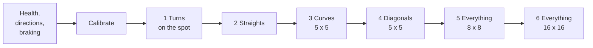
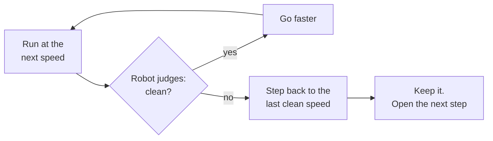
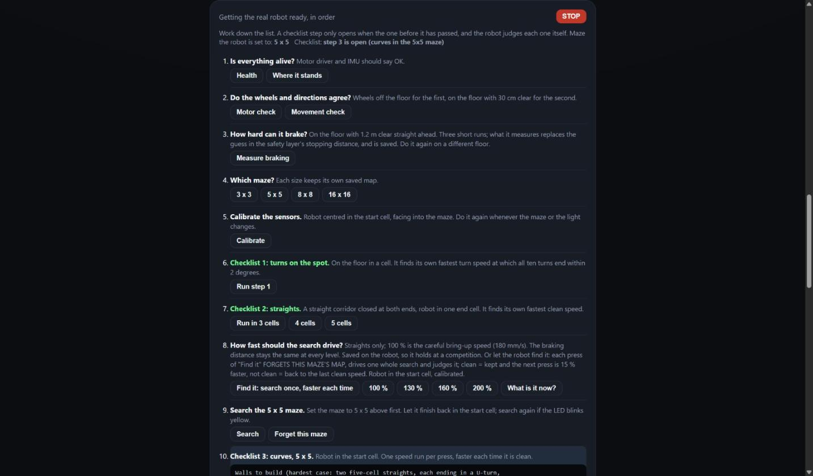
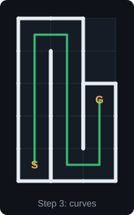
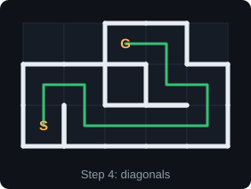
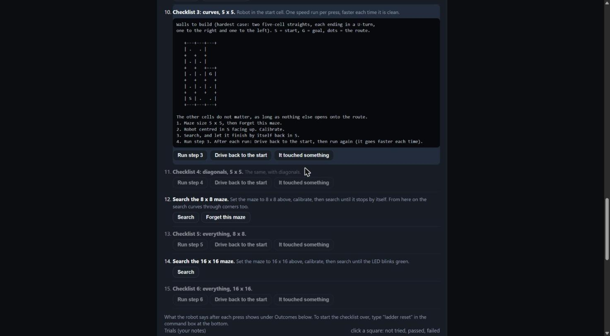
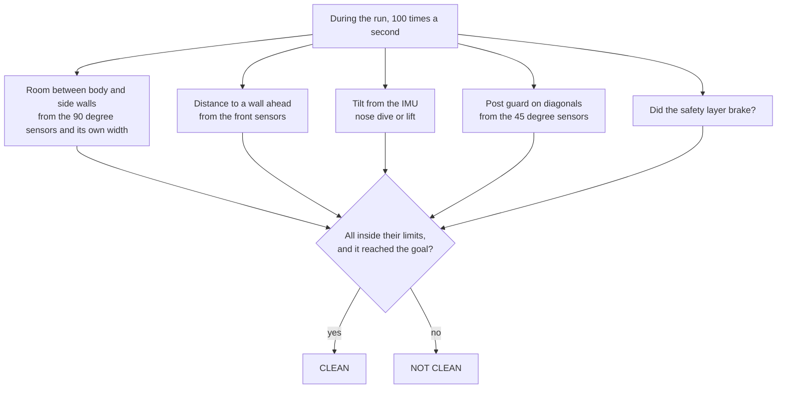
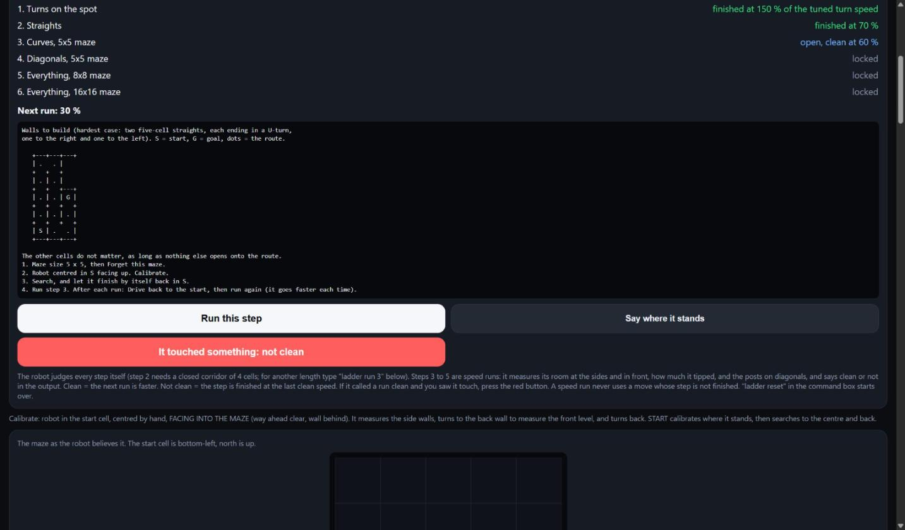
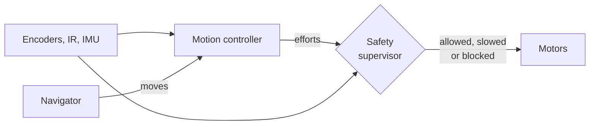
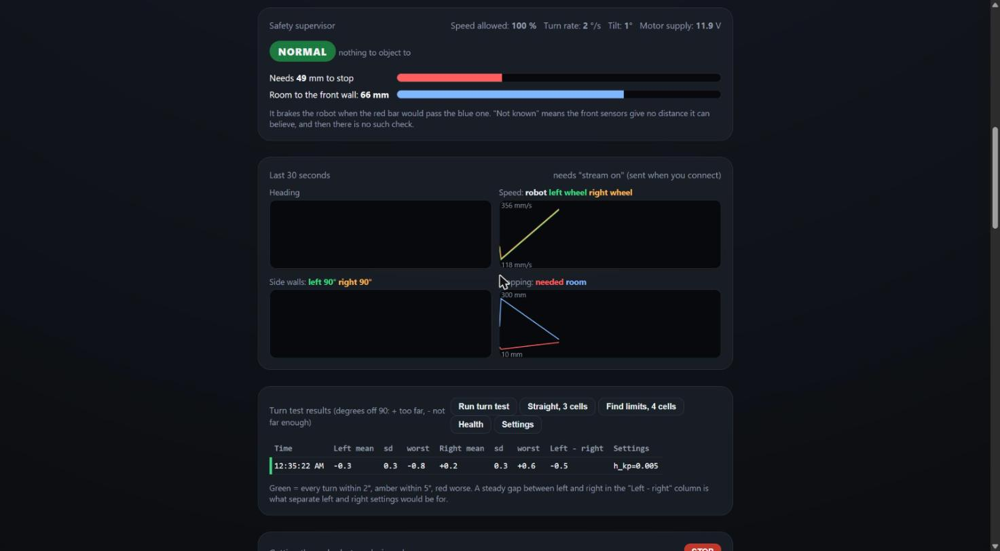

# Micromouse-2027: control, safety and tuning (`pid-controls` branch)

Firmware, a simulation lab and two browser pages for getting a micromouse to drive as fast as it cleanly can. The robot is taken through one kind of move at a time (turns on the spot, straights, smooth curves, diagonals, then whole mazes), and each is pushed to the fastest speed it can do without error before the next is allowed.

It is built on the **Antigravitieee** robot: ESP32-S3-DevKitC-1, Pololu Motoron M2T256, N20 gearmotors with magnetic encoders, Bosch BNO055 IMU, six IR wall sensors.

> **What has been tried, and what has not.** The hand controls, tilt stop, calibration and stop-and-turn search were driven on the real robot on 2026-10-10. **Everything added on this branch has run on the simulated robot only**, including the robot's own checklist code, which is compiled for the PC exactly as it is. The simulator's physics are guesses: it shows that the code works and which way a change pushes things, not what the real robot will do.

**Contents**

1. [The idea](#1-the-idea)
2. [Try it now, without the robot](#2-try-it-now-without-the-robot)
3. [First session with the real robot](#3-first-session-with-the-real-robot)
4. [The checklist, step by step](#4-the-checklist-step-by-step)
5. [The safety layer](#5-the-safety-layer)
6. [At a competition (no computer)](#6-at-a-competition-no-computer)
7. [The simulation lab](#7-the-simulation-lab)
8. [Commands and settings](#8-commands-and-settings)
9. [Checks before flashing](#9-checks-before-flashing)
10. [Using this on another robot](#10-using-this-on-another-robot)
11. [Where things are](#11-where-things-are)

---

## 1. The idea



Every numbered step works the same way:



Three rules follow from that:

- **A step cannot start until the one before it has finished.** A robot that cannot turn cleanly is not asked to curve.
- **What a step proves is what later runs may use.** Until step 3 is finished, a speed run uses only straights and turns on the spot; until step 4, no diagonals. The speeds found become ceilings for everything after.
- **The robot does the judging**, from its own sensors (section 4 says exactly what it measures). You overrule it only when you saw it touch something it could not see.

Underneath all of it sits a safety layer that can stop the robot whatever the rest of the code wants (section 5).

---

## 2. Try it now, without the robot

Needs Windows with WSL (the PC tests already use it).

```
sim\viewer\run_viewer.bat
```

This compiles the real firmware for the PC, starts the lab, and opens <http://localhost:8001/viewer/> after about half a minute. Then:

1. Open the **Lab bench** tab.
2. Press **Run the robot's OWN checklist code**. It takes a few minutes and prints what the robot decided at every step, with the truth beside it.
3. Open the **Replay a run** tab and press **Play** to watch any of it.

Section 7 covers the rest of the lab.

---

## 3. First session with the real robot

### Before you start

| You need | Why |
| :--- | :--- |
| The robot, a charged battery, a USB cable | Flashing, and the first checks |
| Chrome or Edge on the PC | The dashboard uses Bluetooth or USB from the browser |
| 1.2 m of clear floor | The braking measurement |
| Maze walls for: a dead end, a 5-cell corridor, a 5 x 5 maze | Checklist steps 1 to 4 (pictures in section 4) |
| A ruler | Centring the robot in a cell |

### Flash, and open the dashboard

```powershell
~/.platformio/penv/Scripts/pio.exe run -e main -t upload      # with Bluetooth and Wi-Fi, for tuning
cd tools/web_dashboard
python -m http.server 8000
```

Open <http://localhost:8000> and press **Connect** (Bluetooth) or **Connect by USB**. To keep a record of the session, run `python tools/run_recorder/record.py --stream` in another window and connect the dashboard by USB: the recorder takes the robot's one Bluetooth connection and writes everything it prints to `logs/`.

### Work down the card "Getting the real robot ready, in order"



Each row has its own buttons. Green = done, highlighted = open now, dimmed = locked until the row before it passes. **STOP** is at the top right of the card. Lifting the robot and tipping it toward vertical also stops it.

| Row | Do this | You should see | If not |
| :-- | :--- | :--- | :--- |
| 1 | Press **Health** | Motor driver and IMU both OK, motor supply near 12 V | Supply 0 V: motor power is off. IMU not OK: power-cycle with the robot flat on the floor |
| 2 | Wheels off the floor: **Motor check**. Then on the floor with 30 cm clear: **Movement check** | Each wheel does what the step says; `ALL PASS` | A wheel going the wrong way: stop here; the `[MOTORCHECK]` and `[MOVECHECK]` lines say which of the four direction settings in `config.h` to change |
| 3 | 1.2 m of clear floor ahead: **Measure braking** | Three short runs, then `[BRAKE] done` with a braking figure and a delay | "fewer than two speeds measured": it did not reach speed; check the battery |
| 4 | **Maze size** | The line under the heading shows that size | |
| 5 | Robot centred in the start cell by ruler: **Calibrate** | It measures, turns round, measures, and ends facing into the maze; `CALIB SUCCESS` | `REFUSED`: no walls beside it. A warning about the top of the sensors' range: the front distances stay switched off until the emitters are turned down |
| 6 | **Checklist step 1** in a dead end | It turns left and right in sets of ten, faster each set, then `Step 1 ... FINISHED at N%` | "NOT passed": the turns need tuning; the `[TURNTEST] done` lines say by how much |
| 7 | **Checklist step 2** in the corridor | It shuttles end to end, faster each time, then `Step 2 ... FINISHED at N%` | "calibrate first": row 5 was done somewhere with no wall behind the robot |
| 8 | **Find it** (search speed) in the 5 x 5 maze | One whole search per press; `Search CLEAN at N%` | It steps back by itself when a search is not clean |
| 9 | **Search** the 5 x 5 | It drives to the centre and back and stops facing into the maze; green blinks = best route proven | Yellow blinks: press Search once more |
| 10, 11 | **Checklist steps 3 and 4**, pressing **Drive back to the start** between runs | `Clean at N%. Next: ... at N+10%` each time, then `FINISHED` | Pressed when you saw it touch: **It touched something** |
| 12 to 15 | The 8 x 8 and the 16 x 16: **Search**, then **Checklist steps 5 and 6** | As above | |

**Before row 6, read this:** step 1 saves the robot's tuning by itself if it finds a better value for holding the spot in a turn. Make sure no half-tried value is live in the Tuning card.

**Before row 7, read this:** step 2 drives at the end wall faster each time. The safety layer is its backstop, and the first time is the first time. Keep a hand ready to lift the robot.

### What to capture when something is off

| What happened | Capture |
| :--- | :--- |
| Anything at all | The newest file in `logs/` |
| Turns wrong | The `tune` listing and the `[TURNTEST] done` lines |
| It stopped by itself | The `[SAFE]` or `[SAFETY ALERT]` line just before |
| The heading drifts or jumps | `health` twice, ten seconds apart, **with the motors powered** (the `IMU READS:` line) |
| A step will not pass | The `[LADDER] Measured:` line of the failing run |

---

## 4. The checklist, step by step

### What to build for each step

Each step tells you what walls to put up, in the dashboard row and in the phone app. These are the hardest arrangement for that kind of move, so a pass here means something.

| Step 1: turns on the spot | Step 2: straights | Step 3: curves | Step 4: diagonals |
| :---: | :---: | :---: | :---: |
|  |  |  |  |
| Walls left, right and behind: the least room to swing in | Five cells, closed at both ends. Side walls: both, left only, none, right only, both | Two five-cell straights, each into a U-turn, one right and one left | A U-turn, a four-cell straight, then a staircase the robot cuts across |

White lines are walls, the green line is the route, S and G are start and goal, the blue circle is the robot. In steps 3 and 4 the cells off the route do not matter, as long as nothing else opens onto the route. Steps 5 and 6 use an 8 x 8 and the full 16 x 16 maze as they stand.



### What each step does

| Step | What the robot does | It finishes with |
| :--- | :--- | :--- |
| **1 Turns on the spot** | First finds the setting that keeps a turn on the spot (so each turn does not walk it off the cell centre). Then ten turns at the tuned speed, and again at 125, 150, 175, 200 and 250 % | The fastest turn speed at which all ten turns ended within 2 degrees |
| **2 Straights** | Shuttles end to end in the corridor at 20, 30, ... 100 % of full speed | The fastest level where it stopped within 15 mm, stayed within 4 degrees, tipped under 8 degrees and the safety layer did not brake. That level is the ceiling for every speed run |
| **3 Curves** | Speed runs with smooth curves, 20 % then 10 % more each clean run. At the ceiling it goes on: curve speed up 40 mm/s per clean run | The run speed and the curve speed. The search now curves through corners too |
| **4 Diagonals** | The same with diagonals and V turns | Its run speed. Diagonals are allowed from here on |
| **5 Everything, 8 x 8** | The same in a half-size maze | Its run speed |
| **6 Everything, 16 x 16** | The same in the full maze | The speed the robot runs at |

### How the robot judges a run



| It measures | Clean means | Setting in `src/config.h` |
| :--- | :--- | :--- |
| Least room at the sides | 15 mm or more (centred, it has 40) | `LADDER_MIN_SIDE_ROOM_MM` |
| Nearest to a wall ahead | 20 mm or more from the sensor tips | `LADDER_MIN_FRONT_GAP_MM` |
| Most it tipped | 8 degrees or less | `LADDER_MAX_TILT_DEG` |
| Post guard on diagonals | 0.9 or less (1 = a post at twice the alarm level) | `LADDER_MAX_POST_GUARD` |
| Safety brakings | None | |

**What it cannot see:** its own corners and back, side walls while on a diagonal, and any side with no wall. In the simulator it called 40 runs and one of them had really grazed a post by a quarter of a millimetre. That is what the red button **It touched something** is for.

In the phone app (`http://192.168.4.1` on the robot's Wi-Fi `Antigrav-Mouse`) the same checklist is one card:



---

## 5. The safety layer



It is separate from the planner and the controller, runs 500 times a second, and can only take motion away.

| State | When | What it does |
| :--- | :--- | :--- |
| NORMAL | Nothing to object to | Nothing |
| CAUTION | Heading sensor in fault, the two front sensors disagree, or motor supply low | New straight moves start at 60 % of their speed |
| BRAKING | The front wall is inside the stopping distance, or the controller tripped one of its own stops | Ends the move, brakes, aborts the run |
| FAULT | The motor driver stops answering during a move | Holds the motors braked |
| RECOVERY | After BRAKING or FAULT | Holds until the robot has stood still, then lets go. It never restarts a run |

**The stopping distance** is `speed × delay + speed² ÷ (2 × braking) + margin`. It brakes when that is more than the room the front sensors see, less 8 mm.

The delay and the braking strength start as guesses. **Measure braking** (row 3) replaces them: the robot stops from three speeds, and since `distance ÷ speed` against `speed` is a straight line that starts at the delay and climbs by `1 ÷ (2 × braking)`, the three points give both. A fifth of margin is taken on each, and they are saved.



The red bar is what it needs to stop; the blue bar is the room it has. It brakes when red would pass blue. "Not known" means the front sensors give no distance it can believe, and then there is no such check: that is the case until the robot has been calibrated with a wall behind it, or if the front sensors read at the top of their range.

---

## 6. At a competition (no computer)

Flash the build with the radios off: `pio run -e competition -t upload`. Everything the checklist found (speeds, the turn speed, the curve speed, the search speed, the braking figures, the tuning) is saved on the robot and applies in this build too.

There are no buttons. Wait for solid cyan, then put a hand in front of the front sensors and take it away. The LED blinks a stage's colour. **A hand before 5 blinks = next stage. Left alone for 5 blinks = do it.**

| LED blinks | Stage | Then |
| :--- | :--- | :--- |
| Green | Search | Goes at once |
| Yellow | Speed run | Blinks the speed level, 1 to 5 times. A hand = next level. Left alone 8 s, it blinks fast for 2 s and goes |
| White | Reset sensors and calibrate | Goes at once |
| Magenta | Straight trim | 1 blink = 5 mm shorter, 2 = 5 mm longer, 5 = back to zero. Adds up each time, saved |
| Blue | Forget the maze | Goes at once |

**To stop a run:** lift the robot and tip it toward vertical. The map is kept.

**If time is short** (ten minutes for everything): the search is the slow part. Three things shorten it, in order of effect: turn speed (checklist step 1), curves in the search (after step 3), and straight speed (row 8). `SEARCH_RETURN_DETOURS` in `src/config.h` decides how far out of its way the robot goes on the way back to prove the best route: 30 now, 0 = straight home.

---

## 7. The simulation lab

The real firmware (`src/hardware`, `src/control`, `src/navigation`, and the checklist code in `src/ui`) compiled for the PC and driving a simulated robot. Start it with `sim\viewer\run_viewer.bat`.

### Replay a run


The true maze, the robot with its six sensor beams, the path it drove, and in blue the map the firmware itself believes (dotted = not yet known). Below it: play, speed, which run, a scrubber, and a chart (clearance, speed, heading error, sensor readings or motor commands). Clicking an event jumps to just before it.

### Lab bench


On the left, the simulated robot and its surroundings: mass, friction, motor strength, a suction fan, a weak or dead sensor, room lighting, IMU drift, missed encoder counts. Changed settings are outlined. On the right, two ways to run the checklist:

| Button | What runs | Use it for |
| :--- | :--- | :--- |
| **Run** beside a step, or **Run all six in order** | A stand-in for that step, judged by the lab against the truth | Seeing at once which step a change of mass, friction or a sensor fault bites |
| **Run the robot's OWN checklist code** | The robot's code itself: braking measured, all six steps, the search-speed trial, its own judge deciding | Checking that the code the robot will run works, and how its verdicts compare with the truth |

### From the command line

```
sim\lab\lab.bat list                              the named scenarios
sim\lab\lab.bat run baseline --trials 5           one scenario on five mazes
sim\lab\lab.bat compare baseline low_friction heavy
sim\lab\lab.bat sweep friction 0.2,0.4,0.7,1      one setting across several values
sim\lab\lab.bat drift worst_case --size 16        does position error build up from turn to turn?
sim\lab\lab.bat experiment checklist              the robot's own checklist code, start to finish
sim\lab\lab.bat experiment brake                  braking distance against the safety layer's sum
```

**Results and progress** (the third tab) lists every scenario run with its trials and the reasons any failed.

### What the simulator says so far

| Question | Answer in the simulator |
| :--- | :--- |
| Does the checklist code run to the end? | Yes: all six steps finish, 90 % of full speed in the 16 x 16 |
| A 16 x 16 speed run | 12 to 18 s today; about 9 to 13 s with curves at 350 mm/s |
| A first 16 x 16 search | About 157 s stop-and-turn; about 101 s with curves and double straight speed |
| Does position error build up? | No: the 45th turn is no worse than the 5th (but see the limits below) |
| What breaks it first? | Friction of 0.3 or less on diagonals |

**Limits of the simulator.** No sideways sliding, no wall joints, no weight shift. A turn on the spot never walks the simulated robot off the spot, though it does on the real one. Its sensors were five times brighter than the real ones until that was corrected for the checklist run. Read differences between two runs, not single numbers.

---

## 8. Commands and settings

Typed in the dashboard's command box, the phone app's, or a serial monitor.

| Command | What it does |
| :--- | :--- |
| `health` | Motor driver, IMU, safety layer, supply |
| `ladder` | Where the checklist stands |
| `ladder run` / `ladder run 5` | Run the open step (the number is the corridor length for step 2) |
| `ladder fail` | The last run was not clean after all |
| `ladder search` | One judged search at the next search speed (forgets this maze's map) |
| `ladder reset` | Start the checklist over |
| `limits brake` | Measure braking for the safety layer |
| `limits 5` / `limits clear` | The straights test alone / remove the speed ceiling |
| `turntest` | Ten turns on the spot, measured |
| `searchspeed 130` | Search straights at 130 % (saved) |
| `maze 5` | Maze size 3, 5, 8 or 16 |
| `tune` / `tune t_hold 0.01` / `tune save` | List the tuning, change one value, save the set |
| `stop` | Stop |

Where the numbers live:

| What | Where |
| :--- | :--- |
| Pins, dimensions, speed limits, every threshold | [`src/config.h`](src/config.h) |
| Tuning (32 live values) | The table `kTune` in `src/control/motion_controller/motion_controller.cpp`; a set saved on the robot overrides it |
| What the checklist found | Saved on the robot: `ladder` shows it |

---

## 9. Checks before flashing

```powershell
~/.platformio/penv/Scripts/pio.exe run -e main -e competition -e calibration
wsl.exe -d Arch -- bash -lc 'cd /mnt/c/Users/jstnp/Micromouse-2027 && python3 sim/tests/test_firmware_nav.py && python3 sim/tests/test_firmware_drive.py && python3 sim/tests/test_lab_models.py && python3 sim/tests/test_checklist_sim.py'
```

| Test | What it shows |
| :--- | :--- |
| `test_firmware_nav.py` | The navigation code on thousands of mazes with an ideal robot |
| `test_firmware_drive.py` | Drivers, motion controller, safety layer and navigator driving the simulated robot |
| `test_lab_models.py` | Each lab setting pushes the result the way physics says it should |
| `test_checklist_sim.py` | The robot's own checklist code runs to the end on the simulated robot (a few minutes) |

---

## 10. Using this on another robot

The control and navigation code reaches the robot through exactly two things:

1. **[`src/config.h`](src/config.h)**: wheel diameter and spacing, body size, encoder counts, sensor positions, speeds, limits.
2. **Four classes in [`src/hardware/`](src/hardware/)**: `Encoders`, `Motors`, `IRSensors`, `IMU`.

The simulated robot is the proof: the PC tests replace those four with a physics model and the rest runs unchanged.

| What you have | What to do |
| :--- | :--- |
| Same parts, different body or wheels (Ratatouieee's `src/` is laid out the same way) | Edit `config.h`, then go down the checklist |
| A different IMU or motor driver | Rewrite that one class behind the same public functions |
| Distance sensors, not IR brightness (Cheesieee's VL53L1X) | Rewrite `IRSensors` to fill the same `IRReadings`. Real millimetres make the front and side distances simpler, and IR calibration is not needed |
| A different processor (Cheesieee is a Teensy 4.0) | Also replace `main.cpp`: the four tasks become one 500 Hz timer and a main loop, and saved settings move to EEPROM. **This has not been done** |

Three parts can be taken on their own: the **safety supervisor** (it takes plain measurements), the **dashboard** (it only reads `[TEL]`, `[SAF]` and `[LADDER]` text lines), and the **simulation lab** (a robot is a list of numbers, `sim/lab/params.h`).

---

## 11. Where things are

| Path | What is in it |
| :--- | :--- |
| [`src/`](src/) | The firmware: only what goes on the robot. `config.h` first, then `hardware/`, `control/` (with `safety/`), `navigation/`, `ui/` (with `ladder/`, `limits_test/`, `turn_test/`), `wireless/` |
| [`sim/lab/`](sim/lab/), [`sim/viewer/`](sim/viewer/) | The simulation lab and its page |
| [`sim/tests/`](sim/tests/) | The PC tests |
| [`sim/mazes/checklist/`](sim/mazes/checklist/) | The wall layouts of checklist steps 3 and 4 |
| [`tools/web_dashboard/`](tools/web_dashboard/) | The dashboard for the real robot |
| [`tools/run_recorder/`](tools/run_recorder/) | Records the robot's output over Bluetooth |
| [`bench/`](bench/) | One bench test per peripheral, and the calibration commands |
| [`docs/`](docs/) | [Operator manual](docs/INSTRUCTIONS.md), schematic, pictures |
| [`AGENTS.md`](AGENTS.md) | The full history: what was tried, measured and decided, in order |

### Hardware notes that are not on the schematic

- The motors are **N20 12 V gearmotors** (30:1, magnetic encoders), not the Faulhaber 1524 on the schematic.
- The **IR channel numbers on the schematic do not match the sensor positions**. The pin map in `src/config.h` is the one verified on the robot:

  | Channel | Position | Emitter GPIO | Receiver GPIO |
  | :--- | :--- | :--- | :--- |
  | CH1 | Left 90° | 15 | 3 |
  | CH2 | Front-left 45° | 16 | 8 |
  | CH3 | Front-left centre | 17 | 1 |
  | CH4 | Front-right centre | 14 | 10 |
  | CH5 | Front-right 45° | 18 | 2 |
  | CH6 | Right 90° | 19 | 9 |

- The status LED is the DevKit's on-board RGB LED (GPIO 48 or 38, depending on the board version).

### Branching

Create your working branch off the bot you are working on: `user/<user-name>/<bot-name>/<topic>`.

```sh
git checkout release/ratatouieee
git checkout -b user/arfelix/ratatouieee/pid-rotation-implementation
```

Once your changes are made and tested, open a pull request. Instructions are in the [git workshop](https://github.com/RutgersMicromouse/git-workshop).
